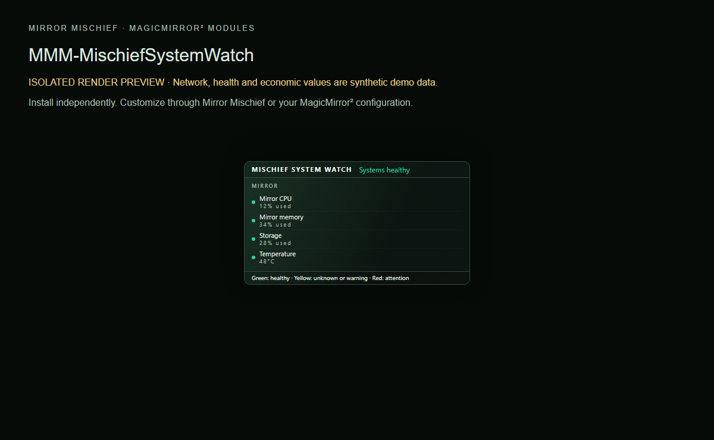

# MMM-MischiefSystemWatch

Local mirror health and optional external system checks.

Part of [Mirror Mischief](https://github.com/FoggEyez/Mirror-Mischief). Install and configure manually, or use the optional companion.



Screenshot uses the actual module renderer in an isolated preview. Network/health/economy readings are labelled synthetic demonstration data, not live readings.

## Install

Requires a working MagicMirror² installation, Node.js 22 or newer, and a current browser. Development baseline: MagicMirror² 2.38.0 API. Physical-device compatibility of this newly packaged version remains to be verified; see VALIDATION.md.

```sh
cd ~/MagicMirror/modules
git clone https://github.com/FoggEyez/MMM-MischiefSystemWatch.git
```

No npm runtime dependencies or install scripts. No extra services are required.

Add this to the modules array in config/config.js, then restart MagicMirror²:

```js
{
  module: "MMM-MischiefSystemWatch",
  position: "bottom_bar",
  config: {}
}
```

## Customize

Works without a desktop PC or external server. Shows CPU, memory, storage, uptime, temperature and Raspberry Pi throttling evidence. Missing platform sensors remain unavailable. `displayService` optionally names your user systemd kiosk service; blank disables that check. `snapshotFile` optionally names an absolute version 1 JSON path with observedAt, checks [{id,name,level,detail}] and optional metrics. level is green, yellow or red. Any check names, service names and disk labels belong to your collector. See examples/health-snapshot.json. Missing, future, stale or empty data never means healthy. `density`, `layout` and `placement` control appearance; auto follows the selected MagicMirror² region. The public version uses generic status rows; owner-specific drive graphs and service mappings are intentionally absent.

All supported settings are visible as literal defaults for generated settings editors.

| Setting | Default | Type |
| --- | --- | --- |
| density | `"compact"` | string |
| layout | `"auto"` | string |
| placement | `"auto"` | string |
| panelWidth | `380` | number |
| horizontalMargin | `12` | number |
| verticalMargin | `6` | number |
| offsetX | `0` | number |
| offsetY | `0` | number |
| textSize | `"normal"` | string |
| backgroundOpacity | `96` | number |
| showMirror | `true` | boolean |
| showExternal | `true` | boolean |
| showLegend | `true` | boolean |
| staleSeconds | `120` | number |
| snapshotFile | `""` | string |
| displayService | `""` | string |
| pollSeconds | `5` | number |

## Mirror Mischief companion

Part of [Mirror Mischief](https://github.com/FoggEyez/Mirror-Mischief), a companion designed to make module installation, settings and layout easier. See [MIRROR-MISCHIEF.md](MIRROR-MISCHIEF.md) for setup and availability.

In Mirror Mischief, choose Install from a link, paste this repository URL, then open Module settings. Set your preferences and position, save and run Check setup. The repository folder, JavaScript entry and Module.register name match exactly. companion.json describes supported placement and dependencies; the current companion reads defaults from JavaScript, not this manifest. One instance per mirror is supported in this release; helpers share one configuration per module. For renamed legacy modules, install this version turned off first and disable the legacy counterpart before enabling it. Moon and Quotes retain their existing names: back up and review any local changes before updating their existing folders. No automatic config migration or removal occurs. Ordinary MagicMirror² configuration works without the companion.

## APIs, privacy and cost

No external API, SSH connection, account or key. Local operating-system readings run on the MagicMirror² host. Optional read-only external snapshot integration.

No telemetry or analytics is added by Mischief. Keep private configuration, tokens and collector snapshots outside this repository.

## Update or remove

Review CHANGELOG.md, back up your private config and local customizations, then run git pull --ff-only inside this module folder and restart MagicMirror². To remove, disable/remove its config entry and restart; retain the folder for rollback or uninstall it using your companion. Never overwrite private configuration from an example.

## Development and support

Run npm ci and npm test. See CONTRIBUTING.md and VALIDATION.md. Report reproducible issues through this repository's Issues tab; remove secrets and private addresses.

## Credits and license

Original Mischief health display and local sampler. Linux /proc and /sys sensors, statfs, systemctl and optional Raspberry Pi vcgencmd are read only.

Original Mischief code: MIT, Copyright 2026 FoggEyez. Third-party licenses and data credits remain applicable; see THIRD_PARTY_NOTICES.md.
